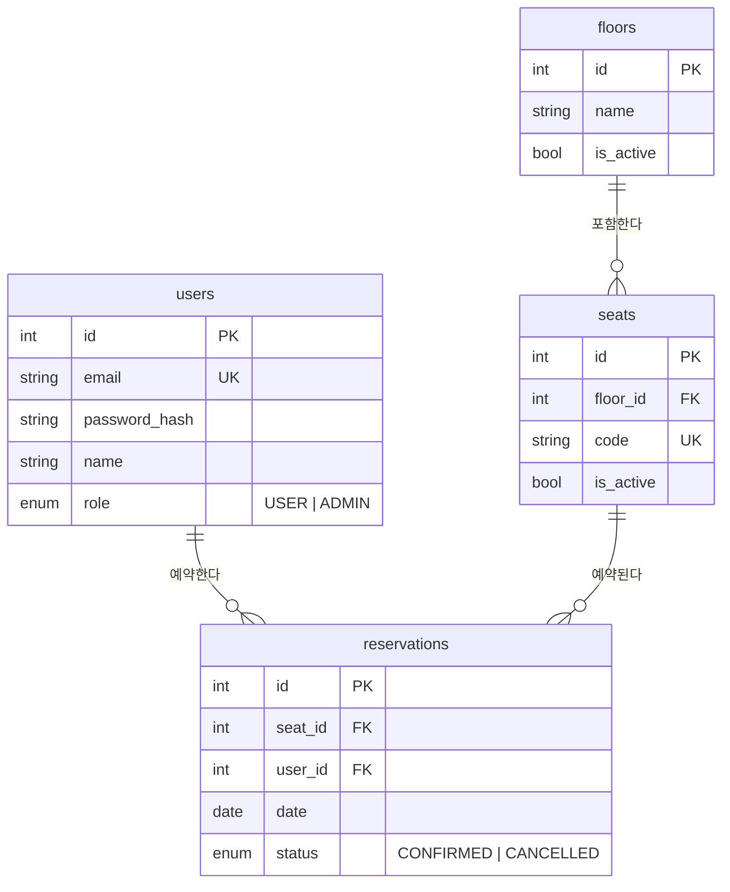

# 도메인 문서 — Gapsang Korea 사내 좌석 예약

이 문서는 "현재 시스템이 무엇을 어떻게 하기로 했는가"의 기준이다.
새 기능을 구현할 때(사람이든 AI든) 이 문서와 `docs/ROADMAP.md` 의 해당 항목을 함께 읽고 시작한다.
구현이 끝나면 이 문서의 규칙·ERD·API 표를 갱신한다.

## 1. 배경 (가상 설정)

- **Gapsang Korea** 는 가상의 IT 회사다. 실제 회사·인물과 무관하다.
- 본사 7층·8층을 사용하고, 임직원은 약 150명, 좌석은 80석이다. 주 2~3일 출근하는 하이브리드 근무라 좌석을 고정 배정하지 않는다(자율좌석제, hot-desking).
- 출근일에 자리가 없어서 돌아다니는 일이 잦아, 전날까지 좌석을 예약하는 시스템이 필요해졌다.
- 운영은 **총무팀**이 맡는다(ADMIN 역할).

## 2. 용어

| 용어 | 영문 | 뜻 |
|---|---|---|
| 층 | Floor | 좌석이 놓인 물리적 층. 예: 본사 7층 |
| 좌석 | Seat | 예약 단위가 되는 책상 하나. 코드로 식별한다. 예: `7F-A-01` |
| 좌석 코드 | code | `{층}F-{구역}-{번호}`. 사람이 부르는 이름이자 좌석맵의 라벨 |
| 예약 | Reservation | 사용자 1명이 좌석 1개를 특정 날짜 하루 동안 쓰기로 한 것 |
| 예약일 | date | `YYYY-MM-DD`. 시각 없음 |
| 상태 | status | `CONFIRMED`(유효) / `CANCELLED`(취소됨) |
| 예약 가능 기간 | reservation window | 오늘부터 며칠 앞까지 예약을 받을지 |
| 사용자 | User | 임직원. 역할은 `USER` 또는 `ADMIN` |

## 3. 비즈니스 규칙 (MVP)

규칙 번호는 코드 주석과 ROADMAP 에서 참조한다. 바꾸면 번호는 유지하고 내용만 고친다.

| 번호 | 규칙 | 위반 시 응답 |
|---|---|---|
| R1 | 예약 단위는 **좌석 1개 × 하루(date)**. 시간대 개념이 없다. | — |
| R2 | 한 좌석은 같은 날짜에 `CONFIRMED` 예약을 **하나만** 가진다. | 409 |
| R3 | 한 사용자는 같은 날짜에 `CONFIRMED` 예약을 **하나만** 가진다. | 409 |
| R4 | 예약 가능 날짜: `오늘(Asia/Seoul) ≤ date ≤ 오늘 + RESERVATION_WINDOW_DAYS(기본 14)` | 400 |
| R5 | 비활성 좌석(`isActive=false`) 또는 비활성 층의 좌석은 예약할 수 없다. | 400 |
| R6 | 취소는 **본인만**, 예약일이 **오늘 이후(오늘 포함)**인 경우만. 삭제하지 않고 상태만 `CANCELLED` 로 바꾼다. | 403 / 400 |
| R7 | 취소된 좌석·날짜는 누구나 다시 예약할 수 있다. (R2/R3 는 `CONFIRMED` 기준) | — |
| R8 | `ADMIN` 은 날짜별 전체 예약 현황을 볼 수 있다. 그 외 API 는 `USER`/`ADMIN` 동일. | 403 |

"오늘"은 서버의 시간대가 아니라 `APP_TIMEZONE`(Asia/Seoul) 기준이다. 계산은 `src/common/utils/date.ts` 에서만 한다.

## 4. 데이터 모델

모든 테이블에 `created_at`, `updated_at` 이 있다. 인덱스와 유니크 제약은 2단계·4단계에서 직접 설계한다(`prisma/schema.prisma` TODO).

## 5. API

인증: `Authorization: Bearer <accessToken>`. `/health` 와 `/auth/*` 를 제외한 모든 API 는 로그인이 필요하다.

| 메서드 | 경로 | 역할 | 설명 | 주요 응답 |
|---|---|---|---|---|
| GET | `/health` | 공개 | 서버·DB 상태 | 200 / 503 |
| POST | `/auth/signup` | 공개 | 가입 `{ email, password, name }` | 201 `{ id, email, name, role }` / 409 중복 |
| POST | `/auth/login` | 공개 | 로그인 `{ email, password }` | 200 `{ accessToken }` / 401 |
| GET | `/users/me` | USER | 내 정보 | 200 `{ id, email, name, role }` |
| GET | `/floors` | USER | 층 목록 | 200 `[{ id, name, seatCount }]` |
| GET | `/floors/:id/seats?date=` | USER | 특정 날짜의 좌석 현황. `date` 없으면 오늘 | 200 `{ floor, date, seats: [{ id, code, status, reservedByMe }] }` / 404 |
| POST | `/reservations` | USER | 예약 `{ seatId, date }` | 201 `{ id, seat: { id, code }, date, status }` / 400 R4·R5 / 404 좌석 없음 / 409 R2·R3 |
| GET | `/reservations/me` | USER | 내 예약 (오늘 이후, 취소 포함, 날짜 오름차순) | 200 `[{ id, date, status, seat: { id, code, floor: { id, name } } }]` |
| GET | `/reservations?date=` | ADMIN | 날짜별 전체 예약 현황 | 200 `[{ id, status, seat, user: { id, name, email } }]` / 403 |
| PATCH | `/reservations/:id/cancel` | USER | 예약 취소 | 200 `{ id, status: 'CANCELLED' }` / 400 과거 / 403 남의 것 / 404 / 409 이미 취소 |

좌석 현황의 `status` 값: `AVAILABLE`(예약 가능) · `RESERVED`(그 날짜에 CONFIRMED 예약 있음) · `UNAVAILABLE`(좌석 또는 층 비활성).

에러 응답 형식(5단계에서 통일): `{ statusCode, error, message, path, timestamp }`

## 6. 결정 기록

왜 이렇게 했는지. 나중에 바꿀 때 "그때 왜 그랬지"를 안 잊기 위한 메모다.

| 결정 | 이유 | 다시 볼 시점 |
|---|---|---|
| 예약을 날짜 단위로 (시간대 없음) | 하루 단위 출근이라 시간대가 필요 없고, 시간 겹침 계산이 빠지면서 동시성 문제에 집중할 수 있다 | 반차·회의실 등 시간 단위 예약이 필요해질 때 |
| 취소를 삭제가 아닌 상태 변경으로 | 이력이 남고, 통계(취소율)를 낼 수 있다. 대신 R7 때문에 "조건부 유니크" 문제가 생긴다 — 이것이 4단계의 핵심 학습 포인트 | — |
| 좌석 속성(모니터 등)을 MVP 에서 제외 | 핵심 규칙(R2/R3)과 무관하고, 있으면 필터 API 가 늘어 범위가 커진다 | ROADMAP #2 |
| 관리자 기능은 "조회" 하나만 | RBAC 를 보여주기엔 엔드포인트 하나면 충분하다. 좌석 관리는 시드로 대체 | ROADMAP #1 |
| 가입을 누구나 가능하게 | 데모·테스트가 쉽다. 사내 서비스라면 이메일 도메인 제한이나 SSO 가 맞다 | ROADMAP #10 |
| "오늘"을 Asia/Seoul 로 고정 | 단일 국가 회사. 서버가 UTC 로 떠도 결과가 같아야 한다 | 해외 지사가 생길 때 |
| 프론트 없이 Swagger 로만 | 백엔드 기초를 보여주는 게 목적. 좌석맵은 백엔드 완성 후 | ROADMAP #5 |

## 7. 범위 밖 (MVP 에서 의도적으로 뺀 것)

좌석 속성·필터, 관리자 좌석 CRUD, 체크인·노쇼, 좌석맵 UI, 팀 구역·고정석, 동료 좌석 찾기, 반복 예약, 주말·공휴일 제한, 이메일 도메인 제한·SSO, 알림, 리프레시 토큰.
각각의 구현 계획은 `docs/ROADMAP.md`.
